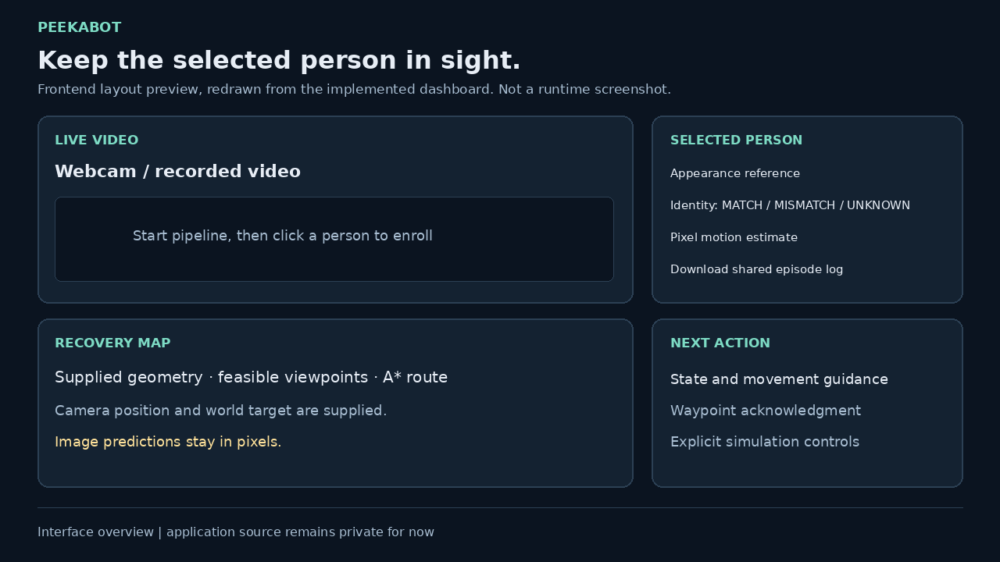
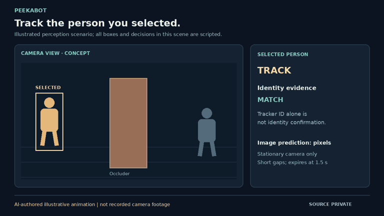
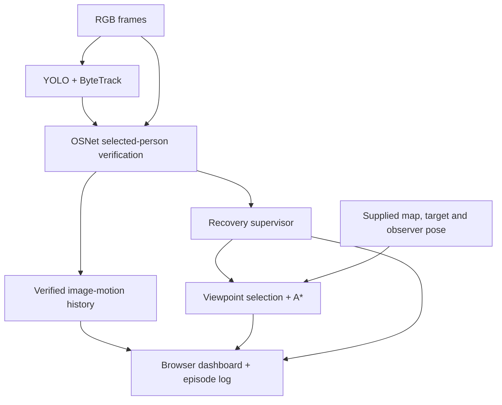

# Peekabot
### Identity-aware person tracking and occlusion recovery

Select a person, keep checking that it is the same person, and reason about how an observer could regain sight after occlusion.

**Public project showcase · University of Pennsylvania, CIS 5810 · Work in progress**

> **The implementation repository is private for now.** This repository contains the project overview, frontend preview, architecture, evaluation plan, and an illustrative proof-of-concept video. It does not contain the private application source, model weights, or participant recordings.

*Frontend layout preview redrawn from the implemented dashboard—not a runtime screenshot. The application combines video, selected-person reference, identity evidence, pixel predictions, supplied-map planning, and shared episode logging.*

[Watch the 24-second concept video](assets/peekabot-concept.mp4) · [Architecture](docs/architecture.md) · [Metrics and validation](docs/evaluation.md) · [Demo scope](docs/demo.md)

## What the project does

A short-term tracker can retain an ID without proving that the same person is still being followed. Peekabot combines detection and tracking with selected-person appearance verification and an explicit recovery state machine.

| Component | Implemented behavior |
| --- | --- |
| Perception | YOLO person detection and ByteTrack short-term association |
| Identity | Click-to-enroll appearance reference; OSNet comparisons; MATCH, MISMATCH, or UNKNOWN evidence; guarded rebinding |
| Motion | Short-horizon image-center extrapolation from verified observations while the camera is declared stationary |
| Recovery | A supervisor handles verification, tracking, brief loss, planning, movement guidance, and timeout |
| Planning | Evaluate viewpoints around a **supplied stationary world target**; reject occluded or unreachable candidates; plan collision-checked A* routes |
| Frontend | Shared browser dashboard for video, reference crop, identity evidence, predictions, map, controls, and system-log download |
| Evaluation | Native-pipeline recording, independent human annotation, per-trial metrics, and grouped CSV reports |

## Proof of concept

**This is an AI-authored explanatory animation, not recorded webcam footage.** Perception boxes and identity decisions are scripted. The recovery-map route is drawn from an actual execution of the project's planner on supplied example geometry. The video does not establish recognition accuracy, recovery success, or physical robot performance.

The animation shows selected-person tracking, an occlusion, viewpoint/route planning, and the metrics used to evaluate real trials. A real-camera benchmark video has not been published yet.

## System overview

**Two coordinate spaces stay separate:** motion predictions are in image pixels; recovery plans use supplied world metres. Pixel-to-world conversion, camera localization, and automatic robot control are not implemented. The predictor returns an estimated center and search radius, not a learned future trajectory.

## My contributions

**Viru Vilvanathan — M.S.E. Robotics, University of Pennsylvania**

My work covers the recovery supervisor and controller, recovery planning integration, identity/motion integration, the shared browser pipeline, and baseline recording with independently labeled evaluation. The public overview is grounded in the current integration branch and its commit history.

Peekabot is a **team course project**. Xinning He implemented the initial detector; Colin contributed the baseline tracker, target memory, and image-motion predictor. I integrated these components rather than claiming sole authorship of the full perception stack.

## Metrics

**Measured baseline values: pending.** No real-trial result files were present in the reviewed integration snapshot.

| Evaluation area | Reported measurements |
| --- | --- |
| Recovery | Correct recovery; recovery within 5 / 10 / 20 / 30 seconds; loss-to-confirmation and visible-to-confirmation time |
| Identity reliability | Wrong confirmations after loss; visible-sample coverage; false-present sample rate |
| Prediction | Availability during the first 1.5 seconds of loss; stationary/zero-velocity diagnostics; future-center error against independent boxes |
| Runtime | Processed FPS; acquisition-to-overlay-log latency at p50 and p95 |

Confirmation requires **current identity MATCH and supervisor TRACK**, with correctness judged by an independent reviewer. Internal IDs and the system's own confidence are not ground truth. Recovery-time summaries must be read alongside failures, censored trials, and sample counts.

[Read metric definitions, validation scope, and the baseline protocol →](docs/evaluation.md)

## Engineering details

- A background worker owns capture and inference; status reads use a separate cache.
- Displayed images, metadata, and enrollment clicks share exact frame tokens.
- Session epochs and route versions reject obsolete commands and waypoint acknowledgments.
- Missing or ambiguous evidence is kept distinct from model/camera unavailability.
- Predictions are cleared when the camera is declared moving and expire after short gaps.
- System events and human outcome annotations are kept separate.

**Stack:** Python · FastAPI · NumPy · OpenCV · PyTorch / OSNet · Ultralytics YOLO / ByteTrack · JavaScript / Canvas · JSONL / CSV.

## Current status

The integration and evaluation tooling are implemented. The private validation notes report **188 passing tests** and one skipped opt-in browser test; that is a source-reported engineering check, not a perception benchmark or a fresh full-suite rerun for this showcase.

Real selected-person occlusion trials, measured baseline comparisons, recorded-video recognition evaluation, and physical route execution remain pending. The supplied-map planner assumes a stationary target and known 2D geometry.

**Source access:** private for now. This showcase will be updated with real trial footage and measured results as they become available.

[GitHub profile](https://github.com/ViruVilvanathan)

