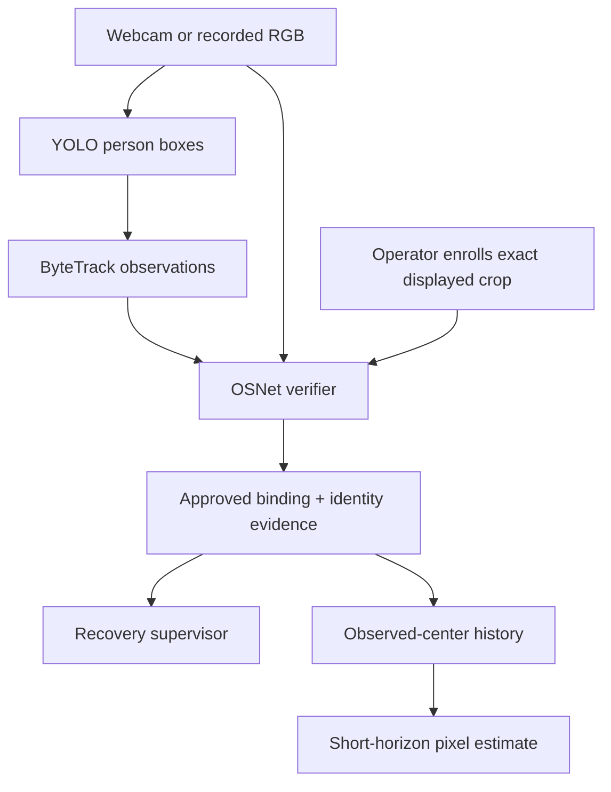
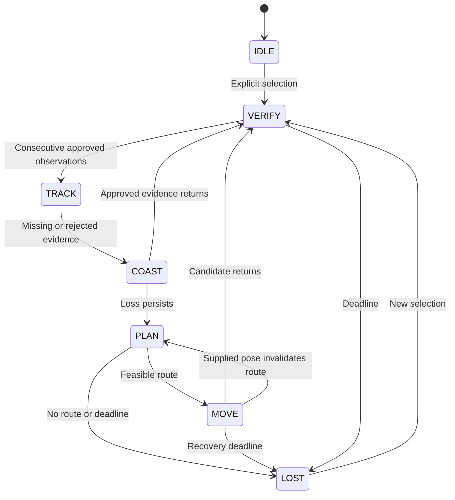
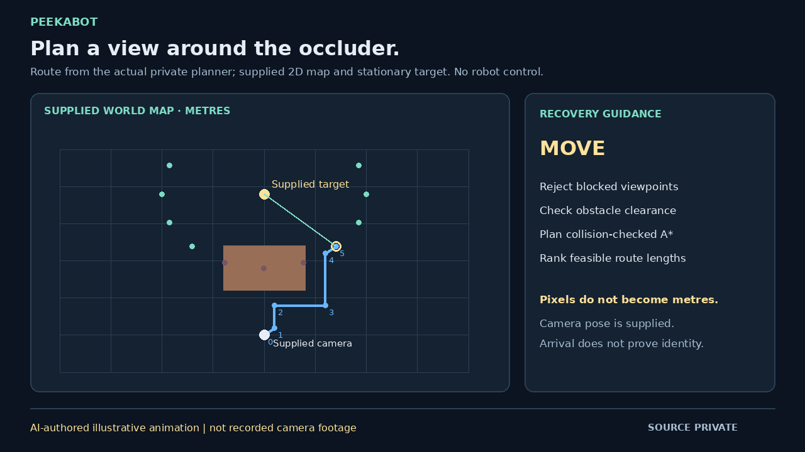

# Architecture and design

[← Project overview](../README.md)

Peekabot separates current visual evidence, selected-person identity, image motion, and recovery guidance. A plausible position estimate does not count as a new observation.

## Perception and identity

A tracker ID is an association mechanism. The verifier compares appearance against the selected gallery and can return MATCH, MISMATCH, or UNKNOWN. Only accepted observations on an approved binding enter the motion history.

The motion baseline estimates pixel velocity from recent observations. It needs a stationary camera and sufficient recent verified samples; it expires after at most 1.5 seconds of loss. It does not predict a full future path or estimate a moving target's world position.

## Recovery lifecycle

This diagram summarizes the principal transitions. Interrupted verification retains its prior recovery context. Planning and verification do not restart the recovery deadline. Arriving at a viewpoint is not proof that the correct person has been recovered.

Default supervisor configuration uses three approved observations, a 0.5-second coast interval, a 30-second acquisition/recovery deadline, and a one-second observation-silence threshold. These are **configuration values, not measured performance**.

## Supplied-map planning

*Visualization of an actual planner output on example supplied geometry; not a measured room or an executed robot route.*

1. Sample viewpoints around the supplied stationary target.
2. Reject viewpoints outside free space or without line of sight.
3. Use A* with obstacle-clearance checks to find reachable paths.
4. Reject routes above the travel budget and rank the remaining route lengths.
5. Present versioned waypoints and a desired viewing direction to the operator.

The default scene samples 16 viewpoints on a one-metre ring. Selection is shortest among the sampled feasible candidates on the planning grid, not a continuous-space global optimum. Movement guidance does not execute motor commands.

## Coordinate boundary

| Visual pipeline | Supplied-map planner |
| --- | --- |
| Original-image pixels | World metres |
| Observed boxes, accepted centers, pixel velocity | Supplied target, obstacle footprints, camera/observer pose |
| Short loss extrapolation | Viewpoint visibility and route planning |
| Stationary camera assumption | Stationary world-target assumption |

There is currently no validated transform between these spaces. Image predictions never overwrite the world target. The map is not reconstructed from camera video.

## Frontend and service

The browser renders data from one server-owned pipeline session. A background acquisition worker runs inference while the HTTP service exposes cached state and bounded JPEG resources. Each enrollment click refers to the exact displayed frame and track.

Run IDs, target-generation epochs, route IDs, and waypoint indices guard against stale actions. Stop, source end, and error states pause movement guidance and release retained images. Real pipeline mode and explicit map-simulation mode do not mix evidence.

The current service is a local, single-operator prototype. It is not a multiuser hosted robotics service.

