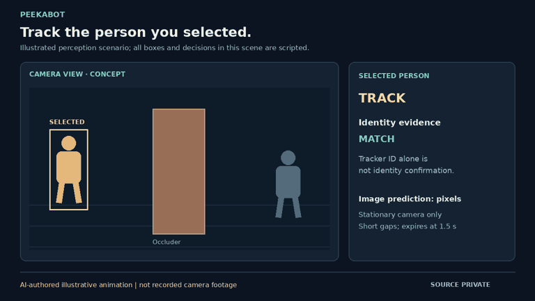
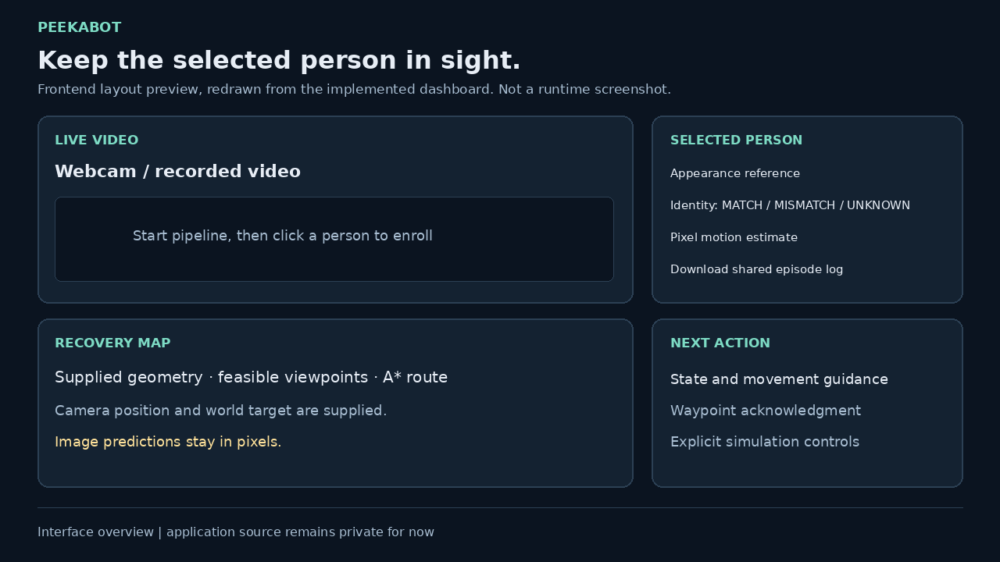

# Proof-of-concept video

[← Project overview](../README.md)

[Download / watch MP4](../assets/peekabot-concept.mp4)

## What you are watching

A 24-second **AI-authored explanatory animation**, rendered programmatically from shapes, labels, and a real planner output. It was not generated by a photorealistic video model and is not a camera recording.

| Segment | What is illustrated | Evidence boundary |
| --- | --- | --- |
| 0–8 s | Selected person, occlusion, and identity-aware tracking | People, boxes, and identity decisions are scripted |
| 8–17 s | Viewpoint and obstacle-avoiding recovery route | Route produced by the actual planner on supplied example geometry; observer motion is not physically executed |
| 17–24 s | Evaluation metrics | Definitions only; measured baseline values pending |

The video carries a persistent illustrative-animation label. It is a conceptual demonstration, not a benchmark or an end-to-end perception run. A real-camera demonstration should be added separately when available.

## Frontend preview

This is a redrawn layout overview based on the implemented browser interface. It is intentionally labeled as a preview rather than a runtime screenshot. The live application has source controls, exact-frame target enrollment, selected-person reference, identity evidence, image-motion prediction, an episode download, supplied-map recovery, and waypoint controls.

## Reproduction scope

The map scene is 4 × 3 metres with one rectangular occluder, a supplied stationary target, and a supplied observer pose. The demo calls the existing recovery controller with an explicit simulation clock and renders its selected route. It does not export private implementation files into this repository.

The source is private for now. The public repository is a portfolio showcase, not an installable release.

